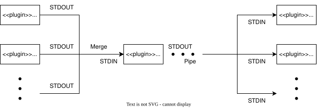

= tfrelay

tfrelay is a toolset for pipelining for terraform's tfstate.
tfrelay is an alpha state.

== Overview

tfrelay relies on plugin system.
plugin has a simple constraint below:

. Read JSON data from STDIN
. Write JSON data to STDOUT

there are 3 kinds of plugins:

Source plugin::
    Data source, writes seed data to STDOUT.
Transform plugin::
    Data transforming, read seed data from STDIN, and writes transformed data to STDOUT.
Sink plugin::
    Data sink, read seed data from STDIN, and writes data to destination defined by each plugin.

== Instruction

=== How to Install

[source,bash]
----
go install github.com/kamichidu/go-tfrelay/cmd/...
----

=== How to Use

[source,bash]
----
terraform plan -out ./planfile

# create config file, see sample.yml
vim .terraform-relay.yml

# will generate output depends on sink plugin
terraform-relay
----

== Configuration

[source,yaml]
----
include::sample.yml[]
----
