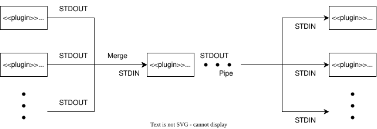

= tfrelay

tfrelay is a toolset for pipelining for terraform's tfstate.
tfrelay is an alpha state.

== Overview

tfrelay relies on plugin system.
plugin has a simple constraint below:

. Read JSON data from STDIN
. Write JSON data to STDOUT

there are 3 kinds of plugins:

Source plugin::
    Data source, writes seed data to STDOUT.
Transform plugin::
    Data transforming, read seed data from STDIN, and writes transformed data to STDOUT.
Sink plugin::
    Data sink, read seed data from STDIN, and writes data to destination defined by each plugin.

== Instruction

=== How to Install

[source,bash]
----
go install github.com/kamichidu/go-tfrelay/cmd/...

# Install the independent XLSX sink module from a repository checkout
cd plugins/sink-xlsx
go install ./cmd/tfrelay-sink-xlsx
----

=== How to Use

[source,bash]
----
# create config file, see sample.yml
vim .terraform-relay.yml

# will generate output depends on sink plugin
terraform-relay
----

The Terraform Source runs `terraform plan -out=.terraform-relay.tfplan` and
`terraform show -json .terraform-relay.tfplan`. Terraform initialization,
backend authentication/configuration, and workspace selection must already be
set up in the working directory.

The XLSX sink is maintained as a separate Go module under
`plugins/sink-xlsx`. Set `TFRELAY_SINK_XLSX_OUTPUT` to the destination path;
the default `-` writes the XLSX file to standard output. The sink writes a
stable `Resources` worksheet with one row per attribute path. Sensitive
attributes are redacted, including nested object and array values, and unknown
values are marked as `<unknown>`. File output is replaced only after the
workbook has been written successfully.

== Configuration

[source,yaml]
----
include::sample.yml[]
----
